<h1 align="center">Keval Pandya</h1>

<b>AI/ML Engineer · GPU Inference &amp; Edge AI · CUDA · TensorRT · DeepStream · LLM/RAG</b>

<h2>👋 About</h2>

<b>Keval Pandya</b> is an AI/ML engineer in Ahmedabad, India, with 3 years of experience designing, developing and deploying
production AI systems across computer vision, GPU inference and edge AI. I have developed and deployed 15+ AI solutions
across industrial automation, logistics, safety monitoring and face recognition, working end to end: model development,
inference optimisation and real-time multi-camera systems with PyTorch, ONNX, TensorRT, PyCUDA, DeepStream and GStreamer,
plus VLM fine-tuning and LLM/RAG applications.

<table align="center">
  <tr>
    <td align="center"><h3>15+</h3>AI solutions delivered</td>
    <td align="center"><h3>5 → 20 cameras</h3>on a single Jetson Orin Nano</td>
    <td align="center"><h3>24 → 60 FPS</h3>gate automation throughput</td>
    <td align="center"><h3>5 s → 500 ms</h3>per frame on Jetson Orin NX</td>
  </tr>
</table>

<h2>⚙️ What I do</h2>
<ul>
  <li><b>Computer vision and edge AI, end to end.</b> Model training, PyTorch-to-ONNX conversion, TensorRT optimisation and hardware-specific rollout on RTX GPUs, NVIDIA Jetson, NPUs and Raspberry Pi.</li>
  <li><b>GPU inference optimisation.</b> Profiling with Nsight Systems, Nsight Compute and trtexec; keeping frames on the GPU from NVDEC decode through pre- and post-processing; pinned memory, CUDA streams and preallocated GPU buffers to raise throughput and control VRAM.</li>
  <li><b>Model and graph work.</b> ONNX graph changes (node fusion, operator simplification, dynamic-shape fixes), FP32/FP16 TensorRT engines, and accuracy checks against the FP32 baseline before deployment.</li>
  <li><b>Multi-camera pipelines.</b> DeepStream and GStreamer pipelines with detection, tracking, re-identification, OCR and face recognition, in Python and C++.</li>
  <li><b>Edge-to-cloud architecture.</b> Multi-camera inference and event processing with Docker, Kubernetes, NVIDIA GPU Operator, RabbitMQ, Kafka, Redis and MongoDB.</li>
  <li><b>VLM and LLM systems.</b> Vision-language model fine-tuning with 4-bit quantisation (Unsloth), LLM/RAG services with FastAPI, Qdrant and FAISS, tracking with MLflow and W&amp;B.</li>
</ul>

<h2>🚀 Selected work</h2>

<table>
  <thead>
    <tr><th align="left">Project</th><th align="left">What it does</th><th align="left">Result</th><th align="left">Stack</th></tr>
  </thead>
  <tbody>
    <tr><td><b>Logistics yard &amp; gate automation</b></td><td>Multi-camera gate system: vehicle detection, container classification, OCR, damage inspection and VLM metadata extraction</td><td><b>24 → 60 FPS</b> gate, 2 → 10 FPS yard; accuracy 85% → 95%</td><td>TensorRT · PyCUDA · VLM · RTX &amp; Jetson</td></tr>
    <tr><td><b>Danger zone monitoring</b></td><td>Real-time industrial safety: detection, tracking and polygon zones that stop machinery on intrusion</td><td><b>5 → 20 cameras</b>, 3 → 10 FPS on one Orin Nano; CPU −60%, VRAM ~7 GB → 3–4 GB</td><td>Jetson Orin · GStreamer · PyCUDA</td></tr>
    <tr><td><b>Multi-camera face recognition</b></td><td>Detection, alignment, embeddings, vector search and anti-spoofing with custom-trained models</td><td>Migrated <b>Python → C++</b> with native threads and preallocated buffers</td><td>ONNX Runtime · TensorRT · Qdrant · FAISS · C++</td></tr>
    <tr><td><b>Industrial anomaly detection</b></td><td>Custom model for small-object and surface-defect detection</td><td>Accuracy 78% → 95%; <b>5 s → 500 ms</b> per frame</td><td>Model architecture · Jetson Orin NX</td></tr>
    <tr><td><b>Automatic number plate recognition</b></td><td>Plate detection with rectification, CTC recognition, multi-frame voting; autoscaled event workers</td><td>Accuracy <b>70% → 95–98%</b>; 3–5 → 11 FPS per camera</td><td>TensorRT · OCR · Kubernetes · KEDA</td></tr>
    <tr><td><b>Object detection &amp; counting</b></td><td>Multi-camera DeepStream pipeline with tracking IDs and line-crossing counts</td><td><b>7 → 15 FPS</b> on a 4 GB Jetson</td><td>DeepStream · TensorRT FP16</td></tr>
    <tr><td><b>Digital twin monitoring</b></td><td>Live person positions on a facility floor map with face recognition and cross-camera re-identification</td><td>Per-camera homography calibration and custom cross-camera association</td><td>CUDA · Re-ID · Face recognition</td></tr>
  </tbody>
</table>

<h2>🧰 Skills</h2>

<h3>📁 Programming Languages</h3>

<h3>🤖 Deep Learning Frameworks</h3>

<h3>⚡ Model Optimization &amp; Inference</h3>

<h3>👁️ Computer Vision &amp; Media</h3>

<h3>💬 NLP &amp; LLM</h3>

<h3>📊 Data Science &amp; Numerical Computing</h3>

<h3>🌐 Python Frameworks</h3>

<h3>🗄️ Databases</h3>

<h3>📦 Messaging</h3>

<h3>🔧 CI/CD &amp; Version Control</h3>

<h3>💻 DevOps &amp; Tools</h3>

<h3>☁️ Cloud Providers</h3>

<h3>🖥️ Hardware</h3>

<h2>🏅 Experience, certifications and community</h2>
<ul>
  <li><b>AI/ML Engineer</b>, WebOccult Technologies Pvt. Ltd., Ahmedabad (Nov 2023 – present). The Visionary award, March 2026.</li>
  <li>NVIDIA-Certified Associate: Generative AI and LLMs (NCA-GENL), 2026</li>
  <li>TensorFlow Developer Certificate, 2024 · AI Programming with Python Nanodegree, Udacity, 2022</li>
  <li>B.E. in Information Technology, Shantilal Shah Engineering College, Bhavnagar (2019 – 2023)</li>
  <li><a href="https://ai.stackexchange.com/users/78733/keval-pandya">AI Stack Exchange</a>: <!--SE:START-->32 answers, 676 reputation<!--SE:END-->; ranked 10th by reputation on the site in 2024.</li>
  <li>Open source: <a href="https://github.com/samson-wang/cython_bbox/pull/14">samson-wang/cython_bbox#14</a>, making the package build on current NumPy.</li>
</ul>

<h2>📈 GitHub stats</h2>

<h2>📫 Where to find me</h2>

⏰ <!--UPDATED:START-->Updated on Thu, 19 Nov 2026<!--UPDATED:END-->

